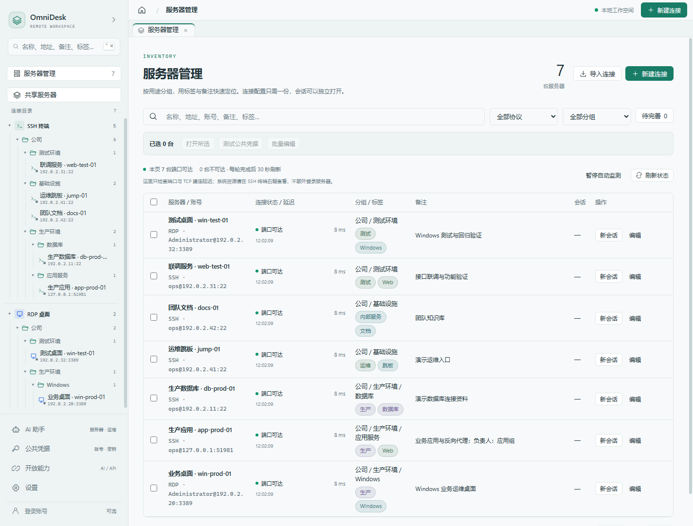
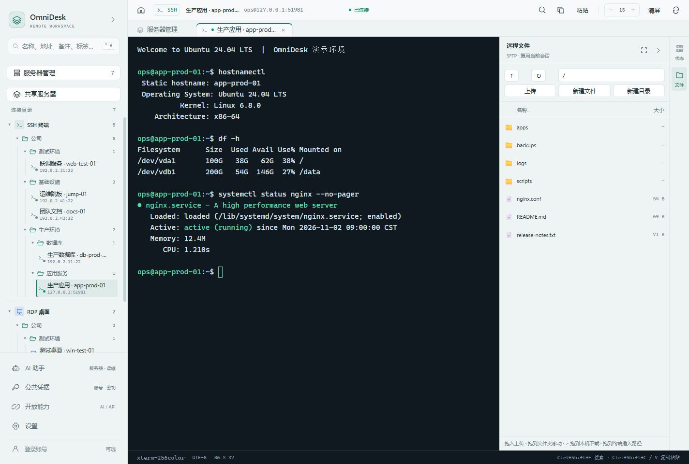
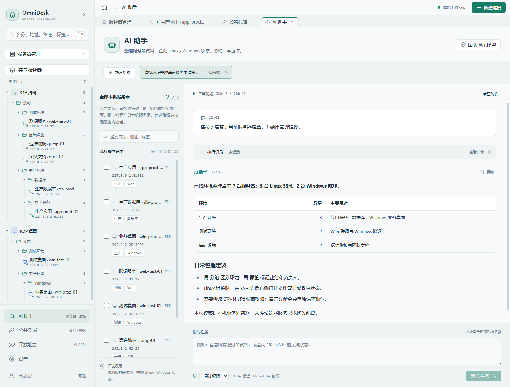
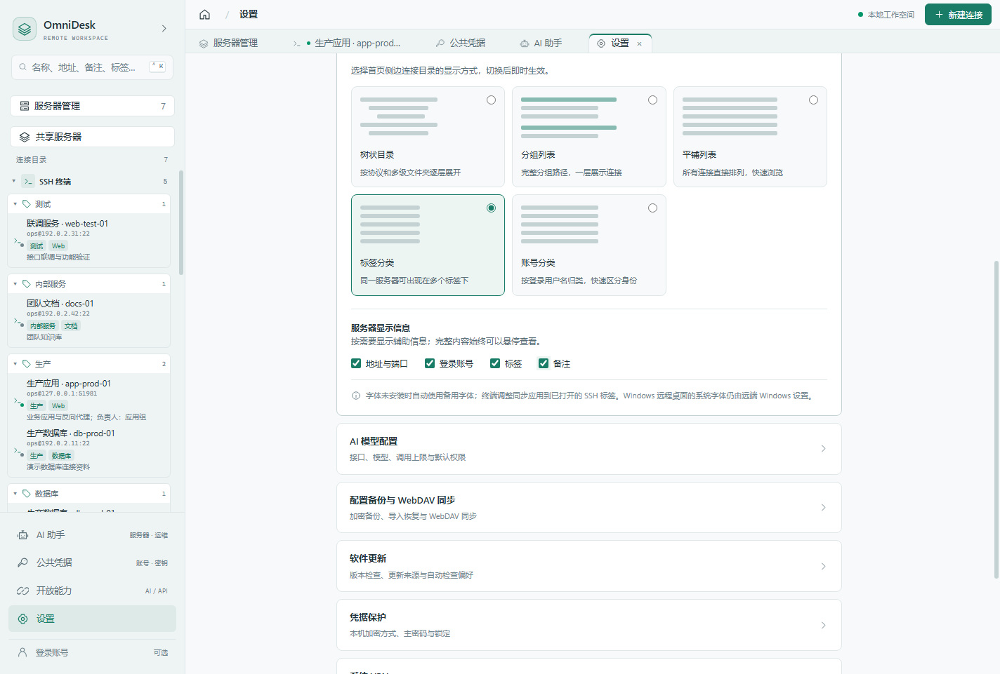

# OmniDesk

> 连接 Windows 与 Linux，并把能力开放给 AI 与其他系统。

一个远程控制工作台。核心设计与传统工具的区别在于：**所有连接与执行能力先做成服务层，界面只是它的一个消费者** —— 所以同一个能力，界面能调、AI 能调、其他系统也能调。

给同事介绍或第一次使用，可以直接阅读 [OmniDesk 同事介绍与上手指南](docs/同事介绍/OmniDesk-同事介绍与上手指南.md)：包含 9 张界面截图、核心优点、首次连接、常用操作与备份迁移步骤。

---

## 下载与安装

Windows x64 **0.6.15**：[下载安装包](https://github.com/jixn-hu/omnidesk-releases/releases/tag/v0.6.15)。文件名为 `OmniDesk-0.6.15-win-x64.exe`，无需 GitHub 登录。更新说明见 [0.6.15 更新说明](docs/RELEASE-0.6.15.md)，验证范围见 [打包验证](docs/VALIDATION-0.6.15.md)。

客户端源码以 [MIT 许可证](LICENSE)公开于 [omnidesk-source](https://github.com/jixn-hu/omnidesk-source)，支持学习、修改和再分发。账号后台是独立服务，不在本次客户端源码发布范围内；SSH、RDP 与本机连接管理可独立使用。自行构建见 [构建指南](docs/BUILDING.md)。

本版新增服务器拖拽整理、树状 / 分组 / 平铺 / 标签 / 账号五种目录、地址 / 账号 / 标签 / 备注显示开关、SFTP 文件拖拽，以及 Windows 文件粘贴时自动按需传输。公开附件包括安装 EXE、blockmap、更新元数据和校验文件。

安装包尚未数字签名，请核对同页 `SHA256SUMS.txt`。升级前先导出加密备份并保存备份密码，结束会话、退出旧版后安装；无需删除现有连接或公共凭据。使用方法见 [用户指南](docs/USER-GUIDE.md)，后续发布按 [源码与安装包发布流程](docs/PUBLISHING.md) 操作。

---

## 现在能做什么



> 本页截图使用演示数据，来自 2026-11-03 的演示构建；目录样式、AI 新快捷键等近期调整以团队提供的客户端版本为准。端口可达不代表账号认证成功。

### Linux 远程控制（SSH）
- 密码 / 私钥 / SSH Agent 三种认证
- xterm.js 终端，多标签保留会话与历史输出，侧边栏可调宽度、可收起，同一连接可以打开多个独立会话
- 终端搜索（`Ctrl+Shift+F`）、字号调节、选中复制、粘贴与原地重连
- **主机密钥校验（TOFU）**：首次连接展示 SHA256 指纹，之后必须匹配；变更时高亮警告
- SFTP 文件管理：浏览、文本编辑、上传、下载、右键新建文件 / 目录、重命名、删除，拖到文件夹移动、从本机拖入上传、通过 ↗ 拖出下载，以及拖入 SSH 插入远程路径
- 服务器监控：CPU（分核/负载）、内存、磁盘、网络、进程 TOP



### Windows 远程控制（RDP）
- 支持鼠标后退 / 前进侧键、五键组合按压、横向滚轮及高精度 / 快速滚动；远程画面获得键盘焦点时，Ctrl+Shift 等组合键交给远端，不再误触本机搜索或新增连接。支持浏览器导航键及 PrintScreen 扫描码；本机系统保留的快捷键仍可能被操作系统截获
- 默认优先使用 TLS / NLA，兼容旧服务器时逐连接征求用户同意，不修改服务器安全策略
- Windows x64 内置桌面默认统一使用 **FreeRDP**：本机独立辅助进程，在当前标签页显示，支持键鼠、中文输入、双向文本 / 文件 / 文件夹剪贴板与三档画质；兼容旧连接配置，系统客户端回退保留。IronRDP 暂用于原有凭据测试及其他平台。构建与验证见 [FreeRDP 接入说明](docs/FREERDP.md)
- 键盘（扫描码 + Unicode 双通道）、鼠标、滚轮：普通字母按真实按键转发，支持远端 Windows 输入法；本机中文输入法只在选字完成后发送文字，预编辑拼音和选字按键不发给远端。失焦、切换标签或断开时释放按键并取消未提交输入
- 文本剪贴板双向同步：本机复制后切回桌面自动同步，Ctrl+V / Shift+Insert 先同步再粘贴；FreeRDP 支持复制文件 / 文件夹。本机到远端使用 Ctrl+V 或工具栏「粘贴」；远端到本机在本机文件夹直接粘贴，系统请求内容时才自动下载。服务器内部粘贴继续在服务器完成。传输显示进度并可取消，需开启剪贴板重定向；RDP 暂不支持图片剪贴板、文件拖拽或剪切移动
- 0.6.4 修正部分远端内部复制 / 粘贴被本机旧内容覆盖的情况，涵盖文字、文件、接收缓存后的粘贴及文字 / 文件来回切换；0.6.3 不包含此次后续修复。远端内部图片等格式保持由服务器处理，不代表新增跨端图片剪贴板。
- 每台 Windows 连接可选「流畅 / 均衡 / 清晰」：自动配置分辨率，流畅最高 1600×900、均衡最高 1920×1080、清晰优先原生像素；保持窗口比例，旧连接保留原参数，选择后下次连接生效
- 自适应分辨率；窗口缩放、最大化和全屏使用合法的 DPI 百分比，修复 `DesktopScaleFactor` 编码错误
- 系统远程桌面初始最大化，按当前显示器设置分辨率，可还原、调整窗口大小和再次最大化
- 系统客户端同时按模式配置色深、字体平滑和桌面特效；流畅 / 均衡固定分辨率上限并默认适应窗口，避免动态分辨率放大后重新变卡；清晰及旧版参数默认不缩放，优先文字清晰度，可独立开启窗口缩放或全屏启动
- 默认先用 TLS / NLA；仅确认目标只接受旧版 Standard RDP Security 时提示，用户同意后自动重连并只保存此服务器的旧版模式。取消、账号 / 证书 / 网络错误及运行中断不会触发降级；风险授权仅保存在本机，换目标或账号后重新确认。不会修改服务器 NLA，或把协商错误误报为密码错误
- 系统远程桌面客户端沿用连接或公共凭据的账号、域和密码，尝试自动登录；缺少密码时由 Windows 询问
- RDP「忽略证书错误」默认开启，方便内网自签名证书连接，但会降低服务器身份验证保障；可对单条连接关闭，明确关闭的设置在编辑时保留，不关闭 NLA
- 关闭忽略后，IronRDP 传输层加载 Windows 系统 CA；FreeRDP 首次使用指纹确认，不冒充系统 CA 自动验证。两者复用目标、有效期和 SHA256 指纹确认及信任记录；可仅信任本次或记住此目标，证书变更时重新确认，确认前不发送 NLA 登录凭据
- 兼容部分旧 Windows RDP 证书的密钥用途限制：仅遇到 `KEY_USAGE_BIT_INCORRECT` 时重连 TLS 1.2 / RSA AES-GCM，不关闭 NLA、不启用 TLS 1.0
- 系统客户端的密码通过标准输入交给 Windows 临时凭据，不出现在命令行或 `.rdp` 文件中；客户端退出后恢复原凭据或删除临时项。Windows 组策略、远端强制询问密码或 MFA 仍可能要求确认，不修改这些安全策略
- 同一目标的系统客户端会话使用独占凭据，需关闭原会话后才能切换账号；系统客户端不支持应用内 SOCKS / HTTP 代理，应改用内置桌面或系统 VPN
- 0.1.2 修正 Windows 隐藏 PowerShell 辅助进程的标准流启动方式，避免凭据已写入却收不到启动结果；错误提示区分启动、凭据写入及结果读取阶段

### 软件更新
- 设置 → 软件更新：从固定 GitHub Releases 源检查正式版，支持手动检查、启动后后台检查、按版本忽略提示；不依赖官方账号
- 自动检查默认开启，成功后每天最多一次；错误明确区分离线、私有仓库 / 无正式 Release、限流，不误报「已是最新」，不会打断 SSH / RDP
- 用户确认后打开官方 Release 页手动下载、安装，不静默覆盖程序；客户端不内置 GitHub Token，不上传本机连接或凭据
- 默认更新源为 `jixn-hu/omnidesk-releases`，客户端提示、实际检查地址与打包元数据统一指向该独立公开仓库；源码仓库不需要公开

### 公共凭据：多个服务，共用一份账号与凭证
- 左侧 **公共凭据** → **新建公共凭据**，填写名称、共享账号、密码或 SSH 私钥，可选 Windows 域
- 编辑 SSH / RDP 连接，在 **凭据来源** 中选择公共凭据；旧凭据未填写共享账号时沿用连接自身的用户名
- 修改一次，下次连接时所有关联主机统一使用新账号和凭证；不会中断已建立的会话
- 列表只显示名称、账号与引用关系，密码和私钥写入本机加密保险箱；正在使用的凭据不能直接删除

### 网络：按连接代理 + 端口转发
- **每条连接独立配置代理**（SOCKS5 / SOCKS4 / HTTP），互不影响，带连通性测试
- **端口转发**三种模式：
  - 本地转发 `-L` —— 把远端内网服务搬到本机访问
  - 远程转发 `-R` —— 把本机服务暴露给远端
  - 动态转发 `-D` —— 本机开 SOCKS5，流量从服务器出去（**等价于只对这台机器生效的 VPN**）
- 规则持久化，带实时流量统计

### 可选的官方账号与共享服务器
- 管理员在服务端 Web 管理台配置 GitLab 地址、Application ID / Secret 和回调，即时生效；通过系统浏览器授权，已有账号可先登录再绑定，保留原同步及共享数据。Secret 加密保存在后台，不回显
- 管理员可开启 / 关闭新注册，同时控制普通注册与 GitLab 首次建号；已有用户仍可登录和绑定
- 共享支持每批最多 50 台的发布 / 更新、批量撤销，按名称、地址、备注和分组搜索选择，单次确认，失败逐条报告；不会撤销其他人的共享或删除本机配置
- 左下角低调的 **账号与同步** 入口支持注册、登录及多设备配置同步；不登录不影响 SSH、RDP、公共凭据、导入导出和 WebDAV，个人同步默认收起；服务管理统一在 Web 后台
- 管理员在服务端 `/admin/#shares` 直接新建或导入 SSH / RDP 配置，集中维护团队服务器；支持搜索、协议 / 来源筛选、编辑、分页和批量删除。JSON / CSV 导入先预览校验，每批最多 1000 台，重复入口跳过；无需先由某个 PC 用户共享。客户端管理员可一键跳转 Web 管理台
- 独立账号服务默认关闭注册，服务端通过 `npm run admin:create` 初始化首个管理员；升级已有后台时保留账号与管理员。网页 `/admin/` 支持开关注册、用户创建 / 停用 / 角色 / 密码重置 / 会话撤销 / 删除，以及 GitLab 配置，不展示密码、私钥或登录密钥
- 手动上传 / 拉取连接、备注、分组和关联凭据；配置加密保存；上传前检查云端，有更新时确认合并并自动重试版本冲突，持续竞争时停止覆盖。同步密钥由官方服务保管，不是服务端无法解密的零知识存储
- 仅主动确认发布的服务器向其他已登录账号可见；按协议和实际连接入口去重，同一服务器只保留一条，个人共享由共享者更新 / 撤销，管理员在 Web 后台可维护全部共享服务器
- 侧栏独立的 **共享服务器** 页面提供目录检索、个人共享和 **拉取到本机**：配置和密码 / 私钥保存为独立本地连接，之后正常连接、编辑和导出；重复入口跳过，不覆盖自己的配置。发布前明确确认其他账号可以获得凭据，撤销不能收回已下载副本
- 共享使用发布时保存的服务器账号和凭据，与个人云端配置备份独立。本机修改密码、公共凭据或 RDP 证书选项后，需再次「发布 / 更新共享」；原共享会更新而非重复新增
- 客户端账号服务地址默认留空，由用户自行填写 HTTP 或 HTTPS 地址，已有手动配置保留；清空地址不删除本机连接。后端独立维护于 `jixn-hu/omnidesk-server`，不再随本仓库构建。配置共享不需要 guacd、目标连通性或云端内网许可，SSH / RDP 流量从用户本机直接连接；旧网关共享需发布者确认后重新发布才允许其他人下载凭据
- 内网自签名 HTTPS 首次连接需核对证书指纹；确认后仅当前服务受信任，换证书重新确认，不修改系统证书库
- 运行方法、安全边界与部署说明见 [官方服务部署](docs/OFFICIAL-SERVER.md)

### 多窗口
- 新窗口与原窗口**共享同一批 SSH 会话** —— 一边看终端，一边开文件管理，互不干扰
- 服务层是单例，会话天然互通，无需同步

### 大量服务器与多会话
- 服务器管理仅显示当前页的 TCP 可达状态与建连延迟，每轮完成后 30 秒刷新，离开页面暂停，不自动登录服务器
- SSH 命令行右侧整合「状态 / 文件」可折叠工具栏：登录后自行点击「状态」才开始展示 CPU、内存、磁盘、网络速率和 SSH 命令往返时间，复用当前会话，每 5 秒采样；新会话及重连不自动开启，收起、切换文件或离开当前会话时暂停，不额外登录
- 右侧文件管理支持目录浏览、上传下载、新建文件 / 目录、重命名、删除文件 / 空目录；右键文件或目录可直接操作，右键空白处可新建 / 上传 / 刷新，支持 F2 重命名和 Delete 确认删除。折叠不丢失当前目录，文件面板记住展开选择；已登录 SSH 可独立打开文件或监控标签页，旧版保存的展开状态不再自动启动监控
- 双击文本文件或右键「编辑文件」打开大尺寸编辑器，支持 Ctrl+S、未保存关闭确认、UTF-8 / BOM 与 CRLF 保留；编辑上限 2 MB，二进制 / 非 UTF-8 文件需下载后打开。新建文件不会截断已有同名文件；保存前检查远端内容变化，失败保留当前修改
- 从远程文件列表把文件或文件夹拖入同一 SSH 终端，即可插入绝对路径；空格、引号、中文和 Shell 特殊字符自动转义，不发送回车、不自动执行。拒绝其他会话路径和控制字符；本地文件仍通过「上传」传到服务器，不把本地路径误当远端路径
- SSH / RDP 会话的地址、状态与操作合并到顶部单行；系统客户端、全屏、终端搜索与字号调整仍可直接使用，隐藏重复工具栏和会话底部的全局状态栏
- 主机地址支持直接填写 `192.0.2.10:9101`、`example.test:2200` 或 `[2001:db8::10]:3390`，按原样保存，不再拆分或改写右侧服务端口。例如主机 `192.0.2.10:9101`、服务端口 `3389` 会完整保留，实际连接使用穿透入口 `192.0.2.10:9101`；没有附带端口时才使用右侧服务端口
- 配置缺少账号、密码、私钥或公共凭据时，侧栏显示琥珀色小标识，服务器管理显示「待完善」；悬停查看原因、点击编辑，也可筛选所有待完善连接。公共凭据与 SSH Agent 按实际认证方式判断，保险箱锁定单独提示；标识只检查本地配置，不验证远端认证
- 侧栏「服务器管理」提供分页列表，直接显示备注、分组、标签、账号和协议；搜索支持多个关键词，包括名称、地址、端口、账号与备注
- 勾选服务器后点击「批量编辑」，可同时整理标签、备注和分组：标签支持添加 / 移除指定 / 全量替换 / 清空，备注支持另起一行追加 / 替换 / 清空，分组支持移入 / 移出；每项默认保持原值。批量变更整批保存，遇到配置冲突不会部分写入，也不会更改连接凭据与协议参数。
- 标签采用彩色胶囊展示；编辑时按 Enter 添加、点击 × 移除，支持粘贴多标签、自动去重和已有标签建议，桌面本机与 Web 共享服务器采用相同交互。
- 多选服务器可批量调整分组、打开连接，或测试公共凭据；单次批量打开最多 12 个会话
- 相同协议、规范化地址与端口视为同一服务器；新增或改变地址遇到重复时需确认。不同账号仍会提醒，可明确保留重复配置
- 「新会话」始终新建独立 SSH / RDP 会话；标签显示序号，关闭一条不影响其他会话
- 服务器管理不再提供「监控」操作，未登录的连接菜单也不提供监控入口。已登录 SSH 按需打开的独立监控可显示 CPU、内存、磁盘、网卡累计流量、速率、进程和最近 30 次趋势；断开时停止采样，不切换其他会话。SSH 响应时间包含命令启动开销，不等同于 ICMP ping
- Linux 通过 SSH 执行内置 sh 脚本；Windows 需要已启用 OpenSSH 与 PowerShell，通过 CIM 和网卡统计采集。仅有 RDP 的服务器仍可在管理页查看 TCP 可达状态与延迟，不提供系统资源监控；TCP 可达不能证明认证成功

### 内置 AI 助手

- 在「设置 → AI 模型配置」接入支持工具调用的模型，用自然语言检索服务器、查询 Linux / Windows 状态和整理连接资料；无需先开启面向外部客户端的 MCP / HTTP API。
- 三种权限控制操作范围：只读用于查询，编辑可新增资料及修改标签、备注、分组；完全权限下，删除本机连接资料和自定义 SSH 命令仍需逐项确认。Windows 状态查询需要 WMI / RPC 与相应账号权限，AI 不操控 RDP 桌面。
- 支持多个后台对话，权限选择在输入框下方左侧；Enter 发送，Ctrl+Enter 换行，空闲对话通过标签上的 × 删除。近期交互调整需使用包含更新的客户端。
- 提问与相关查询结果会发送到所配置的模型服务，请选择团队认可的服务。具体步骤和使用示例见 [同事介绍与上手指南](docs/同事介绍/OmniDesk-同事介绍与上手指南.md)。



### 从 XTerminal / Remote Desktop Organizer 迁移
侧边栏「导入连接」选择来源，先预览再导入：

- 迁移主机、端口、账号、域、备注及分组；读取 XTerminal 已解锁保存的 SSH 密码、私钥 / 口令、身份凭据，以及 RDP 的解密字段
- 密码不出现在预览 IPC 中；勾选导入后写入 OmniDesk 保险箱。无法读取的凭据标记「无凭据」，请在 XTerminal 解锁仓库并保存后重新扫描
- 地址无法读取时仍可从名称推断，标黄并默认不选；可在预览中修正地址、端口和账号
- 默认「只导入新的，跳过重复服务器」，同时检查本机现有连接与当前批次。关闭此项并勾选重复记录，导入前再次确认
- 不修改 XTerminal 文件，不破解未知加密格式；预览凭据缓存 15 分钟后失效

选择 **Remote Desktop Organizer** 后打开 `.rdo` 文件，可以迁移 RDP 名称、主机、端口、域、账号、备注、嵌套目录，以及颜色、音频、显示效果和系统智能缩放设置。支持其经典加密密码和身份卡关联的账号密码；只将解密后的凭据写入本机保险箱，不展示密码，不修改现有公共凭据。未知密码格式会标记为无凭据，不会把密文当密码。

RDO 导入同样默认跳过本机及当前文件内的重复服务器。使用 RD Gateway 或端口异常的记录会提示核对且默认不选；不会照搬关闭 CredSSP 的设置，导入不代表内置 RDP 已支持旧版安全层。解析器只读取有长度、数量和深度上限的数据，不调用 .NET `BinaryFormatter.Deserialize` 或执行文件中的类型。`.rdo` 源文件可能含可恢复的密码，请勿提交到 Git 或上传公开渠道。

### 批量验证公共凭据
- 在「服务器管理」勾选 1–100 台服务器，点击「测试公共凭据」，选择最多 3 条已有凭据，明确开始后才认证
- 串行测试，按勾选顺序、间隔至少 1.5 秒；一台成功后不再尝试其余凭据，可随时停止
- SSH 验证认证成功后立即断开，不开 shell；RDP 实际建立会话后立即释放，保留 NLA 和服务器证书检查
- 不自动更改配置，成功项点击「应用凭据」才建立公共凭据引用；不会显示密码或从字典生成密码
- 失败认证可能触发账号锁定；RDP 验证可能影响服务器上已有桌面会话，请按自己的服务器策略选择次数与时间

### 安全
- 主密码 → scrypt 派生 KEK → 包裹随机 DEK → AES-256-GCM 加密凭据
- 改主密码只重新包裹 DEK，不重加密数据（瞬间完成）
- 明文密码不落盘，主进程只经内存传给渲染进程

### 配置导入、导出与 WebDAV 同步
- **设置 → 配置备份与 WebDAV 同步**，输入非空备份密码，即可导出 `.odbackup` 加密文件
- 备份包含连接、分组、标签、代理、RDP 选项和公共凭据，密码、SSH 私钥及私钥口令一并加密；不包含设备密钥、API 令牌、主机信任记录、WebDAV 密码或本机记住的备份密码
- 另一台设备先初始化 / 解锁保险箱，再输入同一备份密码导入；同 ID 更新、不同 ID 的重复服务器默认跳过、本地其他连接保留，已建立会话不受影响；导入连接的外部访问授权关闭
- WebDAV 填写**服务器地址、账号和密码 / 应用密码**（如 `https://dav.example.com/dav/`），默认保存为该地址下的 `OmniDesk.odbackup`；「备份位置与高级设置（可选）」可设置相对目录和文件名，上传时自动创建备份子目录。旧版完整文件地址会保留原备份位置；测试或上传时自动保存表单，无需先点保存；手动上传，另一台设备手动下载并导入
- 当前是**手动同步**，不是后台定时双向同步；文件采用 AES-256-GCM + scrypt 加密，可将备份密码记住在本机加密保险箱，后续留空即可使用，也可主动忘记；新设备仍需原密码；它与 WebDAV 服务器密码不同
- 默认要求可信 HTTPS；HTTP 须显式接受账号密码暴露风险。不跟随重定向，不忽略 WebDAV 证书错误；有强 ETag 时使用条件请求阻止冲突覆盖；无强 ETag 时明确提示后允许覆盖，兼容不支持 HEAD 的服务器
- 错密码、篡改和取消均不修改本地；导入和 WebDAV 凭据保存带多文件事务恢复。本轮功能验证见 `docs/VALIDATION-0.1.6.md`；此前 WebDAV 表单与兼容验证见 `docs/VALIDATION-0.1.5.md`，RDP / SSH 修复及实测范围见 `docs/VALIDATION-0.1.4.md`，配置同步详细验证见 `docs/VALIDATION-0.1.3.md`

### 开放能力（这是重点）
- **MCP Server** —— AI 客户端（Claude Code / Cursor 等）可直接操作你的服务器
- **HTTP API** —— REST + SSE 流式指标，给看板、告警系统用
- 两者共用同一套服务层，数据必然一致

---

## 安全模型

默认全关，需要用户逐步授权：

| 层面 | 默认 | 说明 |
|---|---|---|
| MCP / API 服务 | 关闭 | 需在界面手动启用 |
| 连接对外暴露 | 全部不暴露 | 需逐个主机打开开关 |
| 写操作 | 需审批 | 界面弹窗确认；可对可信客户端单独关闭 |
| 令牌 | 每客户端独立 | 只存哈希，明文仅创建时显示一次，可单独吊销 |

另外还有两道防护：
- **目标二次校验** —— 授权后若连接配置被改动（比如 host 被换掉），拒绝执行，防 TOCTOU
- **常量时间比较** —— 令牌校验用 `timingSafeEqual`

> 明确不做的事：不全局关闭 TLS 证书校验、不附加 `--disable-web-security`、不静默放行 `certificate-error`。
> 自签名 RDP 证书应先核对确认框中的指纹，可选择记住该目标；只有明确接受风险时才在**那一个连接**上开启忽略证书错误。

---

## 快速开始

```bash
npm install
npm run dev        # 开发模式
npm run build      # 构建
npm run typecheck  # 主进程与界面类型检查
npm run dist:win   # Windows 安装版与便携版，输出 release/<版本>/
node tools/verify-release.cjs  # 检查安装包资源、版本、运行库与便携启动，生成 SHA256SUMS.txt
```

Windows x64 的 FreeRDP 原生构建另需 GCC / CMake / MSYS2 与受支持的 OpenSSL 前缀，首次构建请先阅读 [构建说明](docs/FREERDP.md)。只构建前端 / 主进程不代表已经生成完整 RDP 运行库。

生产运行：
```bash
npm run build
./node_modules/electron/dist/electron.exe .
```

### 首次使用

1. 启动后选择**主密码保护**（至少 8 位，务必记住 —— 无法找回），或免密码的**本机密钥保护**
2. 点 `＋` 新建连接（SSH 或 RDP）
3. 打开连接 → 终端 / 桌面
4. 要用 AI 或 API，去「开放能力」页面启用并建令牌

---

## 接入示例

### AI 客户端（MCP）

```json
{
  "mcpServers": {
    "omnidesk": {
      "url": "http://127.0.0.1:3927/mcp",
      "headers": { "Authorization": "Bearer 你的令牌" }
    }
  }
}
```

提供的工具：

| 工具 | 说明 | 权限 |
|---|---|---|
| `list_connections` | 列出已授权主机 | `ssh:read` |
| `ssh_exec` | 执行命令 | `ssh:exec` |
| `server_metrics` | 结构化运行指标 | `metrics:read` |
| `systemd_logs` | 读 journalctl | `ssh:read` |
| `sftp_list` / `sftp_read_text` | 浏览与读文件 | `sftp:read` |
| `sftp_write_text` | 写文件 | `sftp:write` |

### 其他系统（HTTP API）

```bash
# 主机列表
curl -H "Authorization: Bearer $TOKEN" http://127.0.0.1:3928/api/v1/hosts

# 完整指标
curl -H "Authorization: Bearer $TOKEN" http://127.0.0.1:3928/api/v1/hosts/<id>/metrics

# 精简指标（适合轮询）
curl -H "Authorization: Bearer $TOKEN" http://127.0.0.1:3928/api/v1/hosts/<id>/metrics/summary

# 实时流
curl -N -H "Authorization: Bearer $TOKEN" http://127.0.0.1:3928/api/v1/hosts/<id>/metrics/stream
```

---

## 架构

```
渲染进程 (React)
  连接管理 · SSH 终端 · RDP 画布 · 文件 · 监控 · 开放能力
        ↕  preload（白名单 API，不暴露 ipcRenderer 本体）
主进程 (Node.js)
  ┌───────────── 服务层（能力在这里）─────────────┐
  │ VaultService        凭据加密                  │
  │ ConnectionStore     连接配置                  │
  │ SshService          ssh2 会话池               │
  │ SftpService         文件操作 + 传输队列        │
  │ RdpProxyService     RDCleanPath + TLS 桥      │
  │ MetricsService      指标采集与归一化           │
  │ SettingsService     设置 + 令牌               │
  └──────────────────────────────────────────────┘
  ┌───────────── 出口层（对外）──────────────────┐
  │ McpServer    ↕ AI 客户端                     │
  │ ApiServer    ↕ 其他系统（REST + SSE）         │
  └──────────────────────────────────────────────┘
        ↕ TCP/TLS :22 / :3389
   Linux / Windows 主机
```

**关键设计决策**：

1. **RDP 为什么要代理** —— 渲染进程无法打开裸 TCP。IronRDP Web 首先发送 RDCleanPath 请求，主进程校验每次会话的令牌和固定目标，完成 X.224 协商与 TLS 握手，将协商结果和证书链返回客户端，再转发 TLS 明文应用数据。代理仅绑定 `127.0.0.1`，证书校验只依据该连接的设置，绝不把 RDCleanPath 握手包原样发到服务器的 3389 端口。

2. **主进程用 CommonJS** —— Electron 主进程的 ESM 支持有限，实测 v44 下 `import { app } from 'electron'` 与默认导入都拿不到 API。CJS 是稳妥路径。

3. **指标靠推送脚本而非远端 agent** —— 采集脚本内置在应用里，需要时推到远端 `~/.omnidesk/` 执行，输出结构化 JSON。目标机零依赖，只要能跑 POSIX sh。

4. **sudo 不用管道传密码** —— 那样密码会出现在 `ps` 输出里。改用临时 askpass 脚本 + `SUDO_ASKPASS`。

---

## 连接目录与拖拽

在 **设置 → 外观与字体** 选择树状目录、分组列表、平铺列表、标签分类或账号分类；按需显示地址、登录账号、标签和备注。直接把服务器拖到同协议文件夹即可移动；拖到协议标题移回未分组；拖到标签分类添加标签并保留已有标签。



## 目录结构

```
omnidesk/
├── docs/PLAN.md              功能范围与技术方案
├── src/
│   ├── shared/               主/渲染共享（类型、IPC 契约、常量）
│   ├── main/
│   │   ├── index.ts          入口
│   │   ├── ipc/              IPC 路由（统一错误信封）
│   │   ├── events.ts         服务层事件 → 渲染进程
│   │   ├── services/         服务层 ★ 核心
│   │   ├── mcp/              MCP Server
│   │   ├── api/              HTTP API
│   │   └── assets/scripts/   远端采集脚本
│   ├── preload/              桥接层（白名单）
│   └── renderer/             React 界面
└── tools/                    开发辅助（截图驱动脚本）
```

---

## 开发提示

### 沙箱环境运行

如果环境里设了 `ELECTRON_RUN_AS_NODE=1`，Electron 会以纯 Node 模式启动、拿不到 Electron API。需要清掉：

```bash
env -u ELECTRON_RUN_AS_NODE ./node_modules/electron/dist/electron.exe .
```

无 GPU 的环境加 `--disable-gpu`。

### 界面截图（无头验证）

```bash
OMNIDESK_CAPTURE=./shot.png \
OMNIDESK_CAPTURE_SCRIPT=$(base64 -w0 tools/driver-unlock.js) \
env -u ELECTRON_RUN_AS_NODE ./node_modules/electron/dist/electron.exe . --disable-gpu
```

---

## 状态

已完成：SSH 终端、SFTP、RDP 客户端、监控采集、凭据加密、MCP Server、HTTP API、按连接代理（SSH）、双层主题界面。

**开发环境、构建步骤与验证入口见 [构建与开发指南](docs/BUILDING.md)**，接手开发前请先读它。

设计取舍与功能范围见 [构建与开发指南](docs/BUILDING.md)。

---

## 依赖与许可

- [FreeRDP](https://github.com/FreeRDP/FreeRDP) — Windows x64 内置远程桌面默认协议实现（Apache-2.0）
- [IronRDP](https://github.com/Devolutions/IronRDP) — 兼容平台及凭据测试使用的 RDP 协议实现（MIT OR Apache-2.0）
- [xterm.js](https://xtermjs.org/) — 终端模拟
- [ssh2](https://github.com/mscdex/ssh2) — SSH 客户端
- [Apache Guacamole](https://guacamole.apache.org/) — 共享 SSH / RDP 的服务端会话网关（Apache-2.0）
- [Electron](https://www.electronjs.org/) — 桌面容器

本项目代码 MIT。
