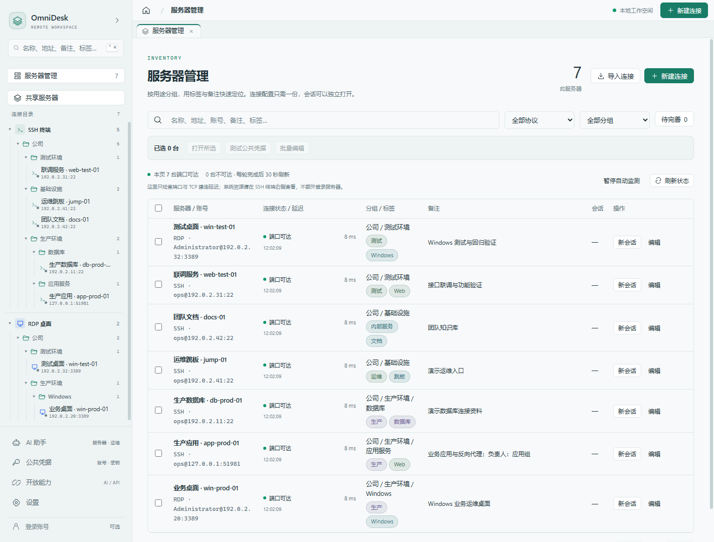
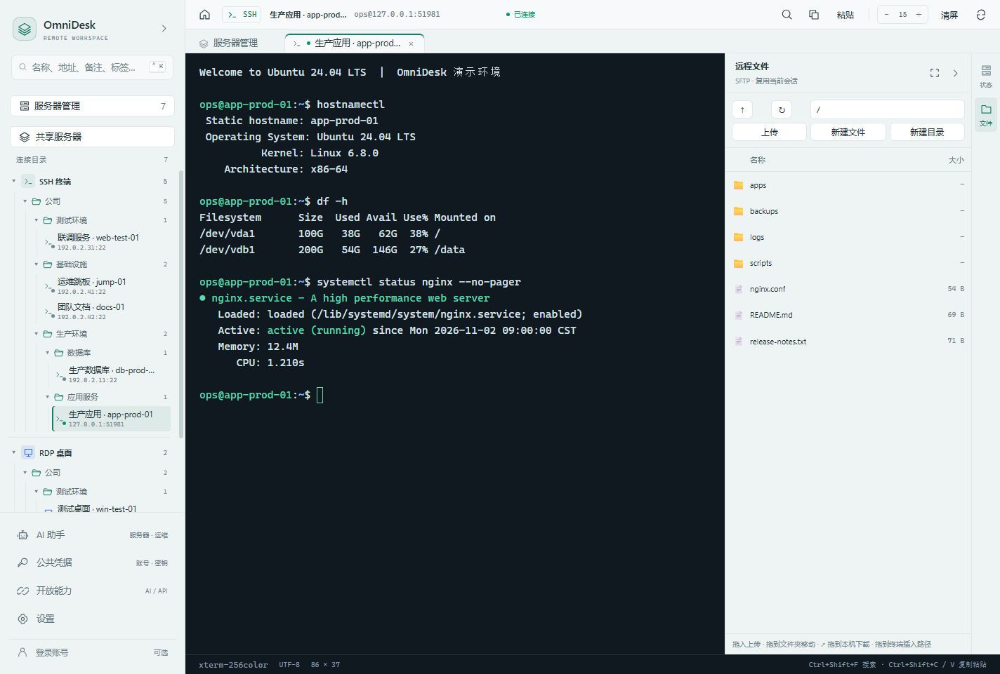
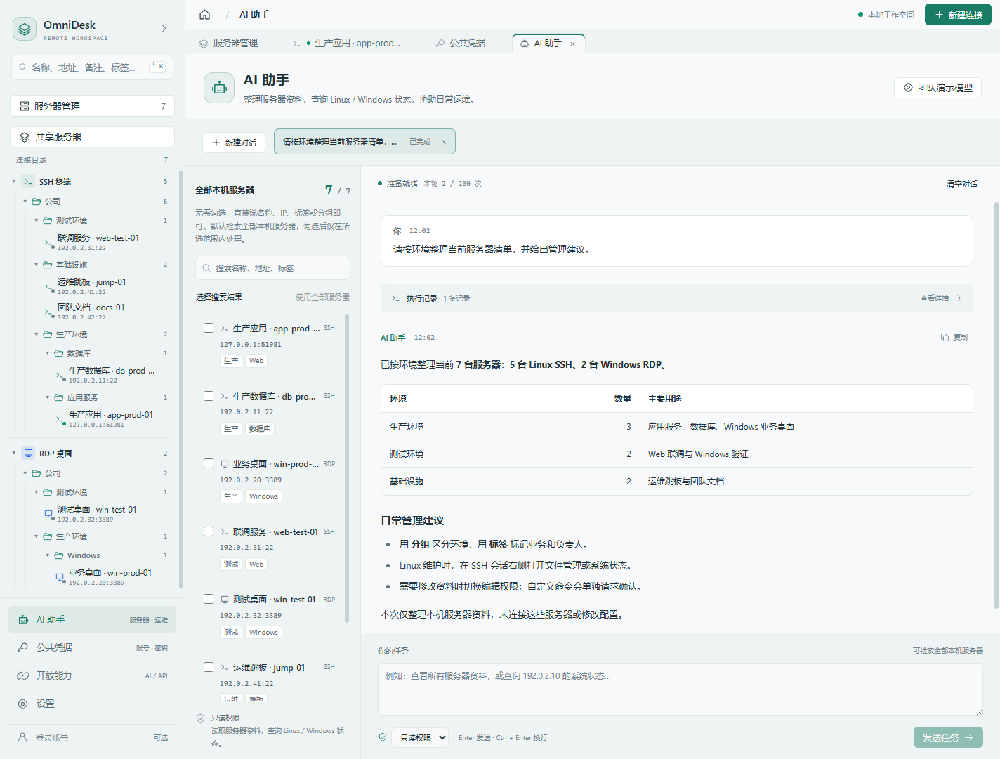

# OmniDesk

Windows 与 Linux 远程连接工作台：集中管理服务器、终端、文件和远程桌面，并在会话内使用 AI 助手。

**[下载 Windows x64 0.6.15](https://github.com/jixn-hu/omnidesk-releases/releases/tag/v0.6.15)** · **[MIT 开源客户端](https://github.com/jixn-hu/omnidesk-source)** · **[同事介绍与上手指南](https://github.com/jixn-hu/omnidesk-source/blob/main/docs/同事介绍/OmniDesk-同事介绍与上手指南.md)**

## 能做什么

- SSH 终端、SFTP 文件管理、端口转发与 Windows RDP 放在一个工作区。
- 服务器按文件夹、标签或账号整理，拖拽即可改分类；可显示地址、账号、标签与备注。
- Linux 文件支持拖入上传、目录间移动与拖出下载；同名文件不会直接覆盖。
- Windows 远端复制后可直接到本机粘贴，需要内容时自动传输；服务器内部复制继续在服务器完成。
- AI 助手支持多个对话、权限选择与操作确认；Enter 发送、Ctrl+Enter 换行。
- 连接资料可加密备份；账号配置同步先合并冲突，再上传。

## 界面预览

以下截图使用合成数据，功能与实际连接效果以安装版本和服务器环境为准。

## 安装和上手

1. 下载 `OmniDesk-0.6.15-win-x64.exe`，用同页 `SHA256SUMS.txt` 核对摘要后运行安装。
2. 新建 Linux / SSH 或 Windows / RDP 连接，填写服务器地址、端口和凭据。
3. 在设置选择目录样式和显示信息。Linux 会话使用终端及文件面板；Windows 会话可开启剪贴板重定向。
4. 使用账号同步时自行配置服务地址，新设备先拉取再上传；升级前导出加密备份并妥善保管密码。

完整步骤与更多截图见上手指南；可下载源码仓库内的 [介绍资料 ZIP](https://github.com/jixn-hu/omnidesk-source/blob/main/docs/OmniDesk-同事介绍资料.zip) 转发给同事。

安装包目前未数字签名。升级前结束会话并退出旧版，再运行安装程序，保留现有用户数据。软件更新只读取正式 Release，下载和安装由用户确认。

## 开源与验证

客户端以 MIT 开源，构建步骤见 [BUILDING.md](https://github.com/jixn-hu/omnidesk-source/blob/main/docs/BUILDING.md)。账号后台是独立服务，不在本次开源范围内；SSH / RDP 与本机管理可独立使用。依赖许可证见源码仓库的 THIRD_PARTY_NOTICES.md。

本版通过本地类型、构建、SSH/SFTP、FreeRDP 协议、Windows OLE 数据对象和成品结构验证；实际生产 Windows 服务器与资源管理器交互、安装向导及全新 Windows 环境仍需使用环境确认。发布前后附件摘要与匿名下载另行核验，不等同于替用户安装或部署后台。
