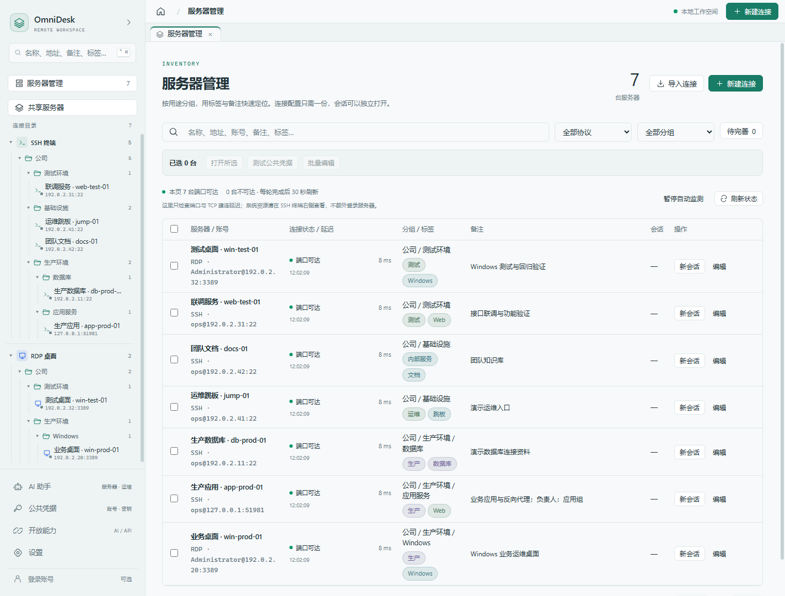
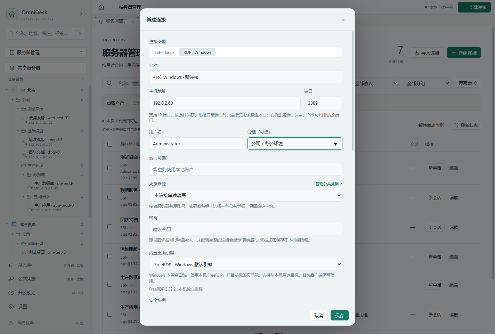
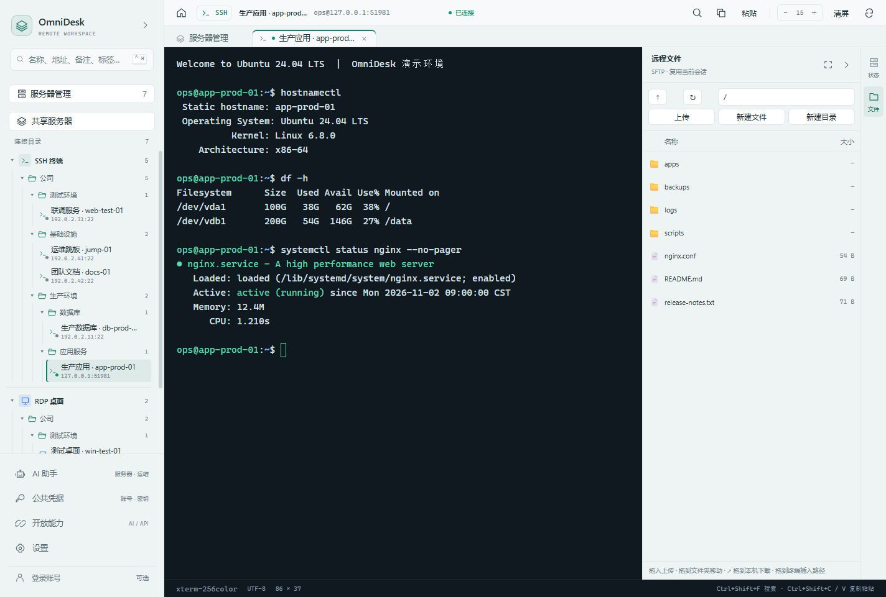
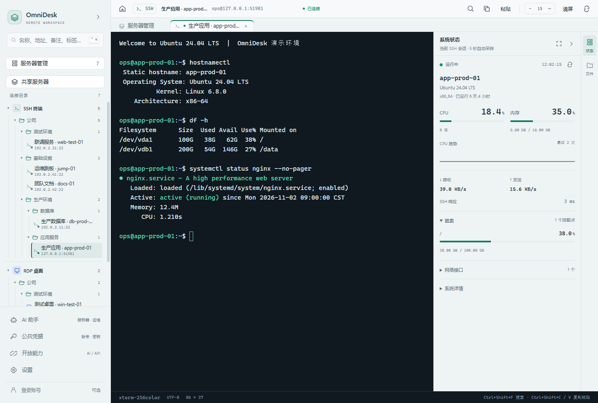
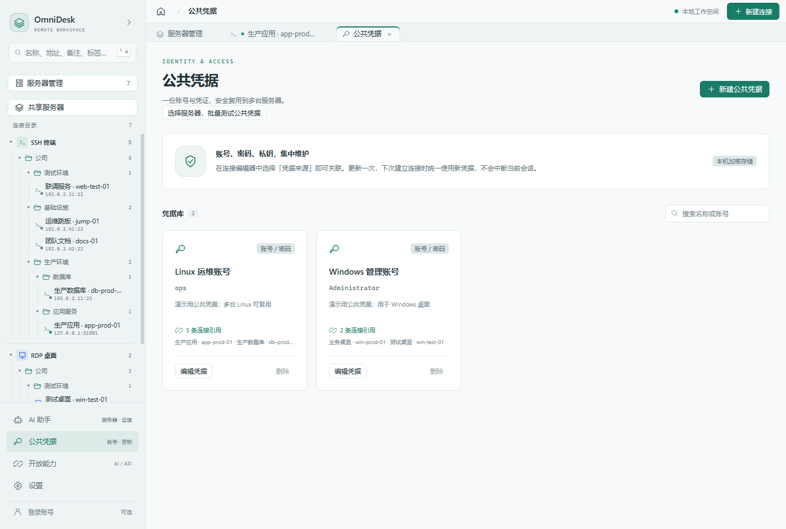
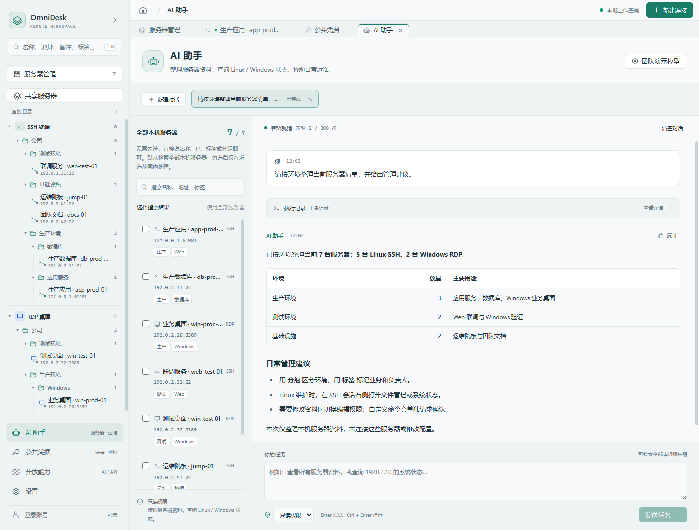
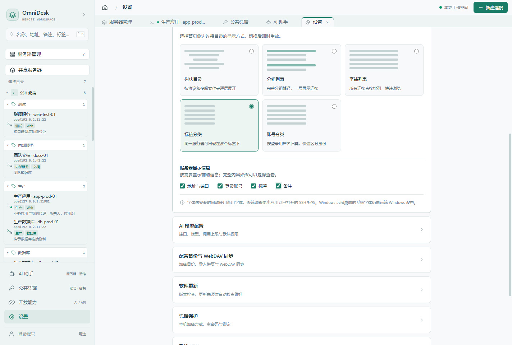
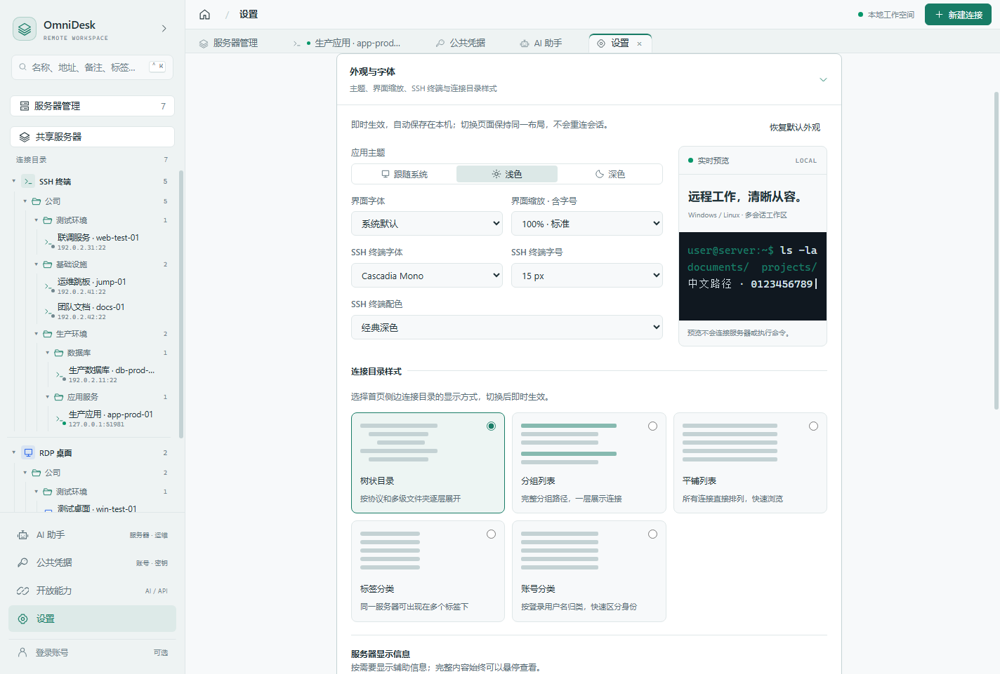
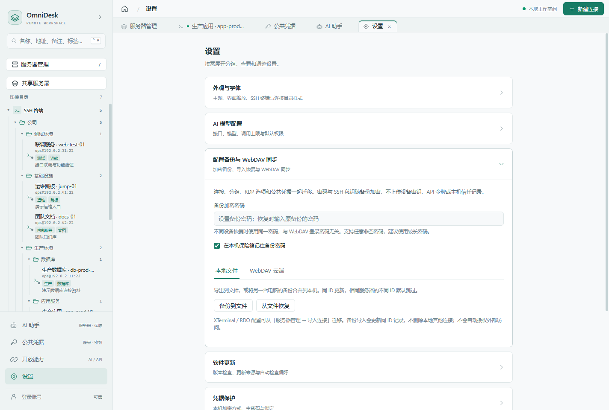

# OmniDesk 同事介绍与上手指南

> 把 Windows 远程桌面、Linux 终端、文件管理和 AI 助手放进同一个工作台。

如果你经常在多台服务器之间切换，还要另外打开文件传输工具、查找连接资料、重复填写账号，OmniDesk 可以把这些日常操作集中起来。开发、测试和运维同事都可以从管理自己的第一台服务器开始使用。

本文先介绍值得用的地方，再按实际操作带你上手，最后介绍团队共享与换机迁移。

**截图说明：**以下 9 张图来自 2026-11-03 的演示构建，服务器、账号、连通状态和监控数值均为演示数据；AI 回复由本地演示服务提供。目录样式切换、AI 新快捷键与同步冲突处理等近期调整，需要使用包含这些更新的客户端，请以团队提供的版本为准。

## 1. 为什么值得用

| 日常需求 | OmniDesk 能做什么 | 对我们有什么帮助 |
| --- | --- | --- |
| 同时管理 Windows 和 Linux | 一个客户端打开 RDP 桌面与 SSH 终端，支持多个会话 | 减少工具切换，连接资料集中保存 |
| 服务器越来越多，不容易找 | 多级分组、标签、备注、搜索与批量编辑 | 按环境、业务或负责人快速定位 |
| 敲命令时还要看文件和资源 | SSH 右侧直接打开文件管理与系统状态 | 排查问题时少开几个窗口 |
| 多台服务器共用一套账号 | 公共凭据被多个连接引用 | 凭据更新一次，后续连接统一使用 |
| 经常整理清单、查询状态 | 内置 AI 助手，按权限调用工具 | 用自然语言完成查询和资料整理 |
| 需要换电脑或与同事协作 | 加密备份、手动同步、可选的共享服务器目录 | 迁移有路径，团队资料更容易交接 |

本机连接、公共凭据和备份功能无需注册账号。需要跨设备个人同步或团队共享目录时，再配置管理员提供的账号服务。



*服务器管理适合查看全貌；左侧目录适合日常快速打开连接。列表中的“端口可达”只说明网络端口能访问，不代表账号认证成功。*

## 2. 几分钟建立第一个连接

### 第一步：安装并选择凭据保护方式

使用团队提供的 Windows x64 安装包，完成安装后启动。首次进入时选择：

- **设置主密码**：至少 8 位，之后启动需要解锁。请妥善保存，遗失后无法找回。
- **暂不设置**：使用本机密钥保护凭据，启动时无需输入主密码。

两种方式都可以开始使用。换机时请使用后文的加密备份，不能仅复制程序文件夹。

### 第二步：准备连接信息

向管理员获取以下信息，并确认本机已接入所需的公司网络或 VPN。

| 目标 | 连接类型 | 常用端口 | 认证资料 |
| --- | --- | --- | --- |
| Linux 服务器 | SSH · Linux | 22 | 用户名、密码或 SSH 私钥，也可使用 SSH Agent |
| Windows 电脑 / 服务器 | RDP · Windows | 3389 | 用户名、密码，按需填写 Windows 域 |

端口以管理员提供的实际值为准。填写地址和凭据不会替你启用远端 SSH 或远程桌面服务。

### 第三步：新建并打开

1. 点击右上角 **新建连接**，选择 SSH 或 RDP。
2. 填写连接名称、主机地址、端口和账号信息；已有公共凭据时，可在 **凭据来源** 中直接选择。
3. 填写分组，例如 `公司 / 测试环境`；补充 `测试`、`Web` 等标签及服务用途备注。
4. 保存后，从左侧目录打开，或在服务器管理中点击 **新会话**。



*图中展示 RDP 连接信息的填写方式，未展示真实 Windows 桌面连接。*

首次 SSH 连接会显示主机指纹。与管理员核对一致后，再选择 **信任并记住**；之后指纹变化时，先确认服务器是否重装或更换。

## 3. Linux：终端、文件和状态一起用

### 一边执行命令，一边管理文件

打开 SSH 会话后，右侧可切换 **文件** 与 **状态**。文件面板支持浏览目录、上传、下载、新建、重命名和删除文件；本机文件 / 文件夹可以拖入上传，远程文件可拖到目录移动，从文件名旁的 **↗** 拖到本机文件夹下载；文本文件可以直接打开编辑，按 `Ctrl+S` 保存。

例如排查一个 Web 服务，可以先在终端查看服务状态，再在旁边找到配置文件或下载日志，不必另外启动文件传输工具。编辑线上文件前，仍应按团队流程做好备份与变更确认。



### 需要时再查看资源占用

连接成功后主动打开 **状态**，即可查看 CPU、内存、磁盘、网络等信息。收起状态面板、切到文件或离开当前会话时会暂停采样，新连接和重连不会自动开启。



同一台服务器可以打开多个独立会话，比如一个看日志、一个执行检查。关闭其中一个会话，不会关闭其余会话。

## 4. Windows：在标签页里使用远程桌面

RDP 连接打开后，可以在工作台内操作 Windows 桌面，支持键鼠、中文输入和文本剪贴板。可同时保留多台服务器的桌面，通过标签切换。

画质可按网络情况选择 **流畅 / 均衡 / 清晰**，先使用默认设置，遇到卡顿再调整。

Windows x64 内置桌面支持文件与文件夹复制：

- **本机到远端**：本机复制文件，在远端粘贴，或点击桌面工具栏的 **粘贴**。
- **远端到本机**：远端复制后，直接到本机文件夹按 `Ctrl+V` 或点击 **粘贴**，自动按需下载，不用再手动接收。只在服务器内部粘贴时不会下载文件。

上述跨端传输需开启剪贴板重定向，暂不支持跨端图片剪贴板、文件拖拽和剪切移动。

## 5. 公共凭据：一套账号，多台服务器复用

如果几台服务器使用同一个账号，可以在左侧 **公共凭据** 中新建一份，再到各连接的 **凭据来源** 中引用。

以后账号或密码调整，更新这份公共凭据即可，后续建立连接时会使用新值，不会中断已经打开的会话。Linux 也可复用 SSH 私钥及私钥口令。



这里的“公共”表示**本机多个连接可复用**，创建后不会自动发布给同事。

## 6. AI 助手：从查清单开始

在 **设置 → AI 模型配置** 中填写团队提供的接口地址、模型名称和 API Key（服务要求时），使用支持工具调用的模型。内置 AI 助手需要单独配置模型服务。

打开左侧 **AI 助手**，可以先尝试：

- “按环境整理当前所有服务器，并列出每组的用途。”
- “找出备注里提到代理池的服务器。”
- “查看生产应用服务器的 CPU、内存和磁盘使用情况。”
- 切换到编辑权限后：“给测试环境的服务器添加‘待回归’标签。”

默认检索全部本机服务器；如果只想操作一部分，可以先勾选目标，限定本轮范围。



### 先选合适的权限

| 模式 | 适合做什么 |
| --- | --- |
| **只读权限** | 检索连接资料、查询 Linux / Windows 状态，适合初次使用 |
| **编辑权限** | 在查询之外，新增连接资料，修改标签、备注和分组 |
| **完全权限** | 还可提出删除本机连接资料、执行自定义 SSH 命令；这些操作需要在确认卡中逐项确认 |

权限选择位于输入框下方左侧。**Enter 发送，Ctrl+Enter 换行**。可以新建多个对话，切换时任务会继续；结束后用对话标签上的 **×** 删除不再需要的对话。

AI 可以查询和执行已授权的工具，但不能代替你操控 Windows RDP 桌面。Windows 状态查询还需要远端 WMI / RPC 可用且账号有相应权限，能连上 RDP 并不代表这类查询一定可用。

提问内容和相关查询结果会发送到所配置的模型服务，请使用团队认可的服务，不要把密码、私钥或令牌写进对话。截图中的清单来自演示模型，用于说明交互方式。

## 7. 按自己的习惯整理工作台

建议分组记录“环境 / 业务”，标签记录“用途 / 负责人”，备注写清服务职责。例如：

```text
分组：公司 / 生产环境 / 应用服务
标签：生产、Web、业务A
备注：业务A接口与反向代理；负责人：应用组
```

服务器多了以后，可以搜索名称、地址、账号、备注和标签，也可以多选后批量整理分组、标签与备注。

**设置 → 外观与字体 → 连接目录样式** 提供五种形式：

| 样式 | 适合的使用习惯 |
| --- | --- |
| 树状目录 | 服务器较多，喜欢按协议与多级文件夹展开 |
| 分组列表 | 希望一次看清每条连接的完整分组路径 |
| 平铺列表 | 连接较少，或主要通过搜索快速定位 |
| 标签分类 | 按环境、业务或地区查看；一台服务器可归入多个标签 |
| 账号分类 | 按登录用户名查看，方便区分不同身份 |

可以打开地址、登录账号、标签和备注显示开关。把服务器拖入文件夹即可移动；拖到协议标题移回未分组；拖到标签分类添加标签，原有标签保留。



同一处还可以调整浅色 / 深色主题、界面缩放和 SSH 字体，按自己的屏幕与阅读习惯设置即可。



## 8. 交接、换机与多设备使用

### 用加密备份迁移自己的配置

进入 **设置 → 配置备份与 WebDAV 同步**：

1. 设置并妥善保存 **备份加密密码**。
2. 点击 **备份到文件**，保存生成的 `.odbackup` 文件。
3. 在新电脑初始化客户端后，进入同一页面，输入原备份密码，点击 **从文件恢复**。

备份包含连接、分组、标签和公共凭据等资料，密码与 SSH 私钥随备份加密。恢复会更新同 ID 记录并保留本机其他连接，相同服务器的不同 ID 默认跳过。备份密码与主密码、WebDAV 登录密码是不同的用途；即使旧电脑记住了备份密码，新设备恢复仍需要原密码。



WebDAV 适合已有网盘或文件服务的同事，填写地址与账号后手动上传、在另一台设备手动下载并导入；它不会在后台持续自动同步。

### 同一账号同步个人配置

团队提供账号服务时，在左下角账号入口填写管理员给出的服务地址并登录，在 **我的配置同步** 中上传或拉取。

- **新设备先拉取**，确认资料完整后再添加或修改连接。
- 上传前会检查云端版本；发现另一台设备更新时，会先让你确认合并，再上传。短暂版本冲突会自动重试，持续冲突时会停止覆盖。
- 合并保留本机独有记录，**同 ID 使用云端内容**，删除操作不会同步到另一台设备。
- 这是手动操作。两台设备都要改同一条记录时，先让第一台上传，第二台拉取后再改，减少相互冲突。

如果提示需要合并，先核对提示中的变更，确认后完成同步；多台设备持续同时修改时，等另一台操作完成再试。不要通过删除本机配置来“重置同步”。

### 从团队目录获取连接

登录后打开左侧 **共享服务器**，找到需要的记录并 **拉取到本机**，之后像自己的连接一样使用。

共享会把所选连接的配置和关联凭据提供给其他已登录账号，发布前要确认共享范围；撤销共享不能收回同事已经下载的副本。个人配置同步与团队共享是两个独立入口。

## 9. 第一次使用遇到问题

| 现象 | 先检查什么 |
| --- | --- |
| 一直连接不上 | 公司网络 / VPN、地址和实际端口、远端服务是否开启 |
| 显示端口可达，但登录失败 | 用户名、密码、私钥、Windows 域，以及远端账号权限 |
| SSH 提示主机指纹变化 | 向管理员确认是否重装或换机，核对新指纹后再处理 |
| AI 无法响应或调用工具 | 模型服务配置、网络和工具调用支持；不影响手动使用 SSH / RDP |
| Windows 能打开桌面，但 AI 查不到状态 | 另外检查 WMI / RPC 与账号权限 |
| 换机恢复失败 | 确认使用原备份密码，而不是主密码或网盘登录密码 |

## 10. 给同事演示的三分钟顺序

1. **展示全貌**：打开服务器管理，说明 Windows / Linux 可以放在一起，演示一次搜索或分组定位。
2. **展示工作流**：打开一台测试 SSH，切到文件，再切到状态，说明常用操作都在当前会话旁边。
3. **展示复用**：打开公共凭据，说明多个连接共用一份账号资料。
4. **展示 AI**：保持只读权限，让助手按环境整理服务器清单，再指出权限选择和操作确认的位置。
5. **交代下一步**：每人先添加一台测试服务器；常用后再配置备份，团队有需要时接入共享目录。

可以这样开场：“OmniDesk 把远程桌面、终端、文件、服务器资料和 AI 助手集中到一个工作台。先用它连上自己的服务器，再按需要用分组、公共凭据和备份，把日常工作整理起来。”
